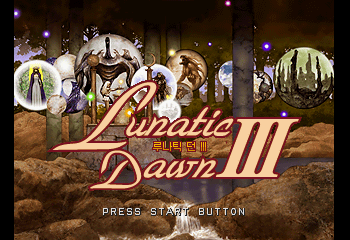
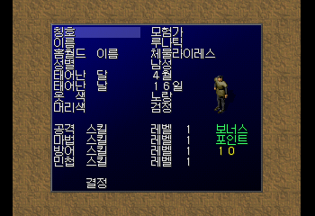
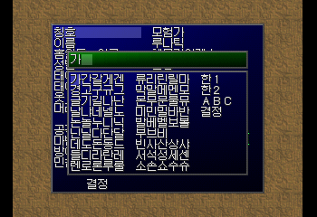
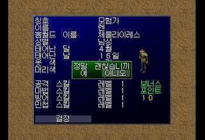
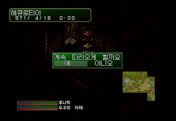
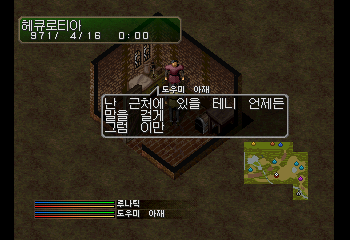
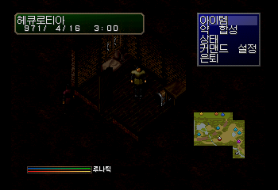
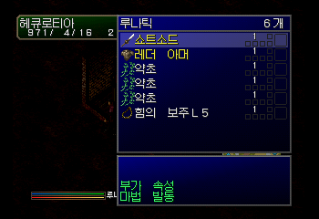
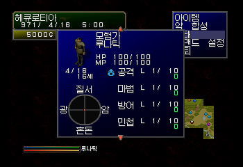
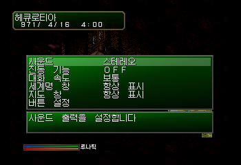

# 루나틱 던 III (PS1) 비공식 한글패치

PS1 일본판 **ルナティックドーンIII (루나틱 던 III, SLPS-01749)** 비공식 한국어 패치입니다. 이 저장소에는 제작 도구와 기술 문서만 있고, 패치 파일(xdelta)은 [Releases](../../releases)에서 받을 수 있습니다. 게임 원본·일본어 원문·번역 대본은 포함하지 않습니다.



## 게임 소개

『루나틱 던 III』는 아트딩크가 1998년 12월에 낸 PS1용 액션 RPG입니다. 정해진 줄거리 없이 모험가 한 명을 만들어, 갈라진 여러 세계를 오가며 술집에서 의뢰를 받고 던전을 탐험하고 동료를 모으며 자유롭게 살아가는 것이 특징입니다. 시간이 흐르면 나이를 먹고, 결혼하고, 수명이 다하면 자식이 뒤를 잇습니다.

## 적용 방법
1. 아래 해시와 일치하는 **원본 `.bin`/`.cue`** (Redump 형식, 데이터 트랙 `(Track 1).bin` + 음악 트랙 `(Track 2).bin`)를 준비합니다. (CHD·PBP·ECM 등으로 변환한 이미지에는 적용할 수 없습니다.)
   - PowerShell: `Get-FileHash -Algorithm MD5 -LiteralPath '.\Lunatic Dawn III (Japan) (Track 1).bin'`
2. xdeltaUI 같은 도구로 **Track 1** 에 xdelta를 적용합니다. (Patch = xdelta, Source File = 원본 Track 1 BIN, Output File = 새 파일명)
   - 명령줄:
     ```
     xdelta3 -d -s "Lunatic Dawn III (Japan) (Track 1).bin" Lunatic_Dawn_III_KO_v1.0.xdelta "Lunatic Dawn III (Korean) (Track 1).bin"
     ```
3. 원본 `.cue` 를 복사해 이름을 바꾸고 **첫 번째** `FILE "..."` 줄만 새 `.bin` 파일명으로 고칩니다. Track 2(음악)는 원본 그대로 씁니다.
4. 만들어진 `.cue` 를 DuckStation 등 PS1 에뮬레이터나 ODE 장치에서 실행합니다.

| 항목 | 값 |
| --- | --- |
| 원본 Track 1 크기 | 283,695,888 바이트 |
| 원본 Track 1 MD5 | `a38d9cac0d8a68b6e3723dcdb95d3779` |
| 원본 Track 1 SHA-1 | `13dc5820d39928eaccfc58269931af7c1c9ba9e3` |
| xdelta 크기 | 230,841 바이트 |
| xdelta SHA-256 | `d1f3aadf0de80d3824cf49a69ed92e3b93264cf88205962bc33a5ce29f7da0bd` |
| 결과 BIN MD5 | `d58ad1dff5d392ff66db207aab6c7563` |
| 결과 BIN SHA-256 | `c9dd3314f610adcebba11e184dc45a1f5b067ed197a46a71a9fc30cd05dde0b9` |

## 주의
- 원본에서 만든 **상태저장(세이브 스테이트)** 은 불러오지 마세요. 글꼴과 문자열 배치가 달라 글자가 깨집니다. 메모리 카드 세이브는 그대로 쓸 수 있습니다.
- 원본에서 만든 세이브의 캐릭터 이름(일본어)은 한글 글꼴에 없는 글자라 깨져 보일 수 있습니다. 새로 시작하는 것을 권합니다.
- xdelta는 압축하지 않은 형식입니다.

## 한글화 내용
- 마을 사람·동료 대화, 술집 주인·의뢰 대사, 의뢰 설명문, 모험 이벤트, 튜토리얼 등 대사 전체 직접 번역
- 메뉴·상태창·아이템·마법·몬스터·지명·종족·직업·칭호 등 이름, 상점·약 합성·옵션·버튼 설정·메모리 카드 메시지
- 캐릭터 생성 화면과 **한글 이름 입력** 표
- 실행 중 들어가는 이름(플레이어·동료·의뢰 대상·장소) 뒤의 조사는 「은(는)」「이(가)」「을(를)」「와(과)」 병기
- 확인창(예/아니오) 문구는 창 너비가 맞도록 조정
- 타이틀 로고 아래 작은 「루나틱 던 III」 표기
- 글꼴: 갈무리11 원래 크기(12px) 한글 826자, 갈무리7(8px) 한글 197자

## 그대로 둔 것
- 원래 영문인 그래픽(NEW GAME, LOAD GAME, OPTION, NOW LOADING 등)
- 음성·음악

## 검증 범위
mednafen PSX 코어에서 타이틀, 캐릭터 생성·이름 입력, 첫 이벤트, 메뉴(아이템·약 합성·상태·옵션·버튼 설정), 술집 튜토리얼·의뢰 게시판·의뢰 수락, 동료 대화, 집 확장, 던전 진입·튜토리얼, 전투 자세 표시, 사망 메시지를 확인했습니다. 다른 세계의 상점, 몬스터 처치·레벨업 메시지 등은 정적 검사만 했고 게임 안에서 띄워 보지는 못했습니다. 문제를 발견하면 Issues에 알려 주세요.

## 스크린샷
| | |
| --- | --- |
|  |  |
|  |  |
|  |  |
|  |  |
|  | |

## 문서
- [CHANGELOG.md](CHANGELOG.md) — 변경 기록
- [docs/TECHNICAL.md](docs/TECHNICAL.md) — 파일 형식과 한글화 방법
- [docs/BUILD.md](docs/BUILD.md) — 직접 빌드하는 방법
- [docs/FONT_CREDITS.md](docs/FONT_CREDITS.md) — 글꼴
- [RIGHTS.md](RIGHTS.md) — 권리 및 외부 자료
